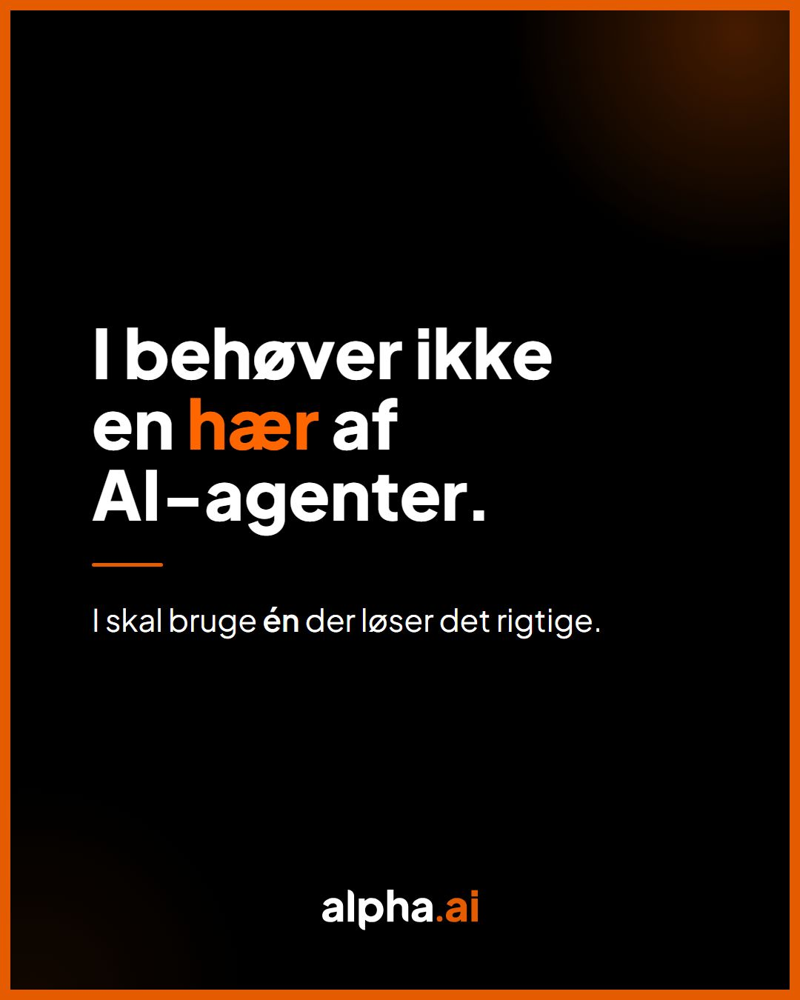
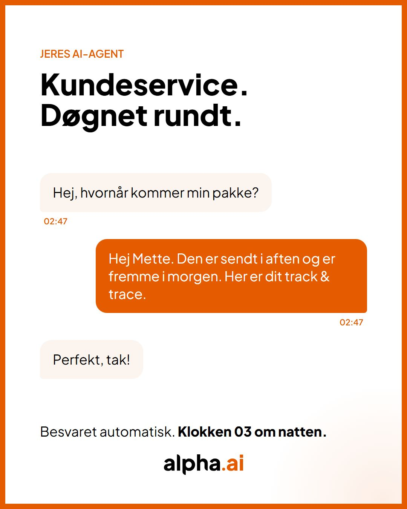
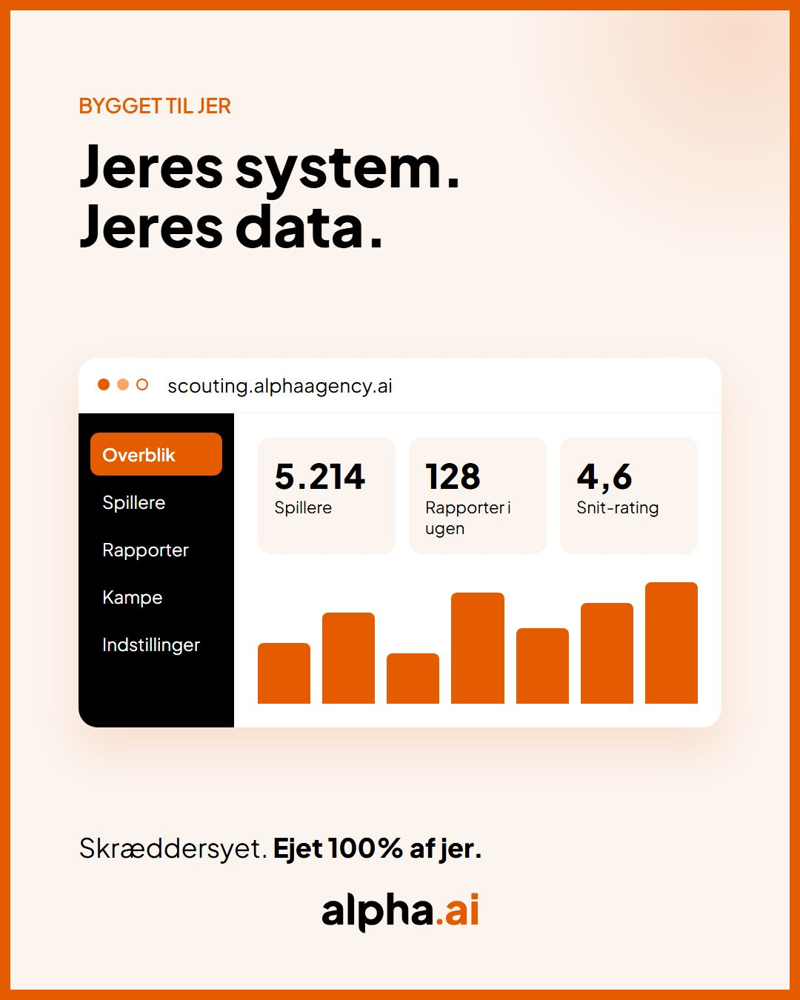
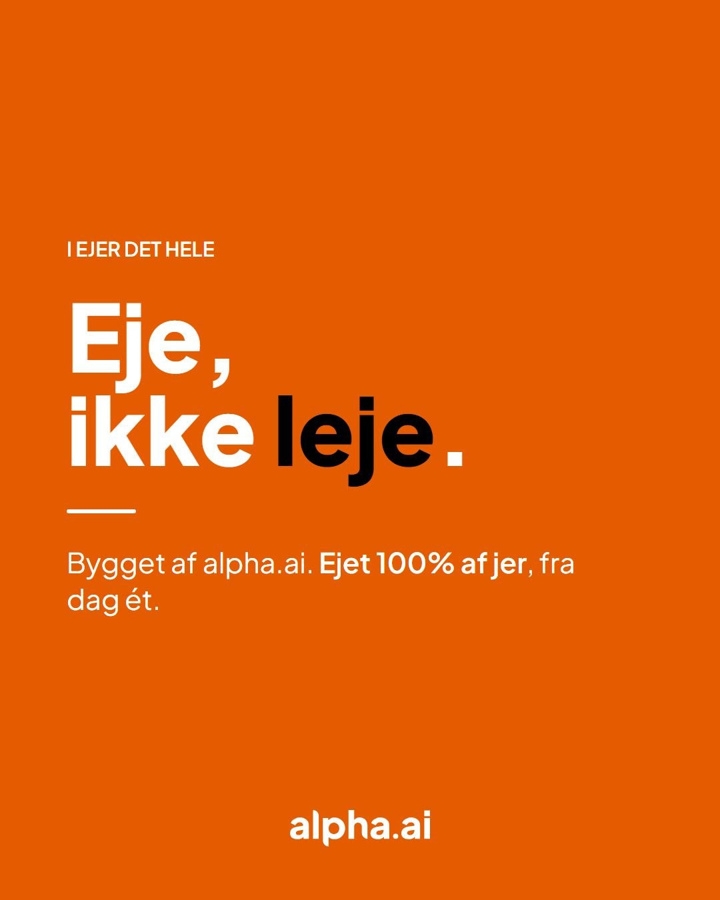

# alpha-skills

Claude skills used by the Alpha Agency team, packaged as a Claude Code plugin marketplace.

| Plugin | What it does |
|---|---|
| `alphaai-linkedin` | Writes LinkedIn posts in alpha.ai's company brand voice (Danish) and renders a matching graphic from seven branded templates. |
| `inbox` | Triages Gmail and your Drag boards in one queue through the Alpha One MCP. Clears the noise in bulk, then walks the rest one item at a time. |

## Examples

The seven `alphaai-linkedin` templates with their sample text, rendered at 1080×1350. They
follow the Alpha AI Brand Guide 05.

| Statement | Statement (dark) | Big number | Chat |
|---|---|---|---|
|  |  |  |  |
| **Dashboard** | **Diagonal** | **Orange** | **Chat, square 1080×1080** |
|  |  |  |  |

The photo template isn't shown: it needs a real photo of someone from the team.

## Install

### Claude Code (Windows, macOS, Linux)

Run these inside Claude Code:

```
/plugin marketplace add AlphaAgencyDK/alpha-skills
/plugin install alphaai-linkedin@alpha-skills
```

Then turn on auto-update so you get changes without doing anything: `/plugin` → **Marketplaces**
→ `alpha-skills` → **Enable auto-update**. Without it, run `/plugin marketplace update alpha-skills`
to pull the latest version.

Try it: *"lav et alpha.ai LinkedIn opslag om ejerskab til håndværkere"*.

**Requirements for the graphics:** Node.js 18+ and any Chromium browser (Chrome, Edge,
Chromium or Brave). Nothing else to install. The skill also explains how to render without
Node.

### claude.ai (web and desktop chat)

An org Owner adds the repo under **Organization settings → Plugins & skills → Add → Sync from
GitHub**. It re-syncs on every push to `main`. The writing works in chat; rendering the
graphic needs a browser, so in claude.ai you get the HTML file and render it from Claude Code.

## Plugin: alphaai-linkedin

```
plugins/alphaai-linkedin/skills/alphaai-linkedin-post/
├── SKILL.md                 workflow: intake → draft → pick → build → render → approval
├── references/brand.md      voice rules, messaging, audience, visual tokens
├── references/templates.md  which template fits what
├── templates/               statement, bignumber, chat, dashboard, diagonal, orange, photo
└── scripts/render.mjs       HTML → JPG/PNG via headless Chromium, any OS, no npm packages
```

Render a template by hand:

```
node plugins/alphaai-linkedin/skills/alphaai-linkedin-post/scripts/render.mjs \
  plugins/alphaai-linkedin/skills/alphaai-linkedin-post/templates/statement.html out.jpg --size 1080x1350
```

Templates fill whatever size they're rendered at, so `--size 1080x1350` (portrait, default)
and `--size 1080x1080` (square) both work from the same file.

## Plugin: inbox

```
/plugin install inbox@alpha-skills
```

Then type `/inbox:inbox`, or just *"clean up my inbox"*.

The first run asks which Drag boards to cover, which cards on them, and whether to log time.
Your answers are saved in `~/.claude/alpha-skills/inbox.json`, so plugin updates keep them. To
change them, type `/inbox:inbox setup`.

**Requirements:** the Alpha One MCP server (`alphaone`), with Google connected under Alpha One →
Settings → Integrations. Connecting Drag and Slack there is optional. Without Drag, the skill
covers Gmail only.

```
plugins/inbox/skills/inbox/
├── SKILL.md             workflow: gather → clear noise → walk → after-send → close out
└── references/setup.md  the first-time questions and the settings file format
```

## Maintaining

- Edit, commit and push to `main`. That's the release. There is deliberately **no `version`**
  in `plugin.json` or `marketplace.json`: every commit counts as a new version, so users with
  auto-update get it without anyone bumping a number. If you add a `version`, you must bump it
  on every change or users stay on the old copy.
- CI renders every template at both sizes on Windows, macOS and Linux and fails if a render
  breaks or comes out the wrong size. The rendered images are attached to each run as an
  artifact, so you can look at them without installing anything.
- Brand copy lives in `references/brand.md`. Sections marked **[AFVENTER BEKRÆFTELSE]** are
  waiting for the alpha.ai positioning update.
- New skill: add `plugins/<name>/` with `.claude-plugin/plugin.json` and `skills/<skill>/SKILL.md`,
  then list it in `.claude-plugin/marketplace.json`. Keep SKILL.md frontmatter to `name` and
  `description` so it also uploads to claude.ai.
- Validate before pushing: `claude plugin validate .`

## License

Code (scripts, template markup) is MIT, see `LICENSE`. The alpha.ai name, wordmark and brand
copy belong to Alpha Agency ApS and are not licensed for reuse.
